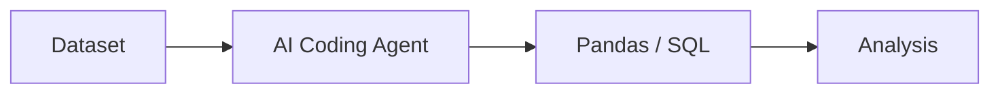
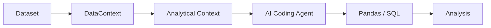
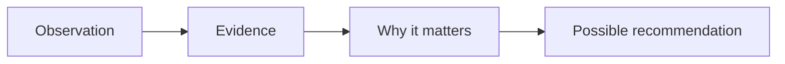
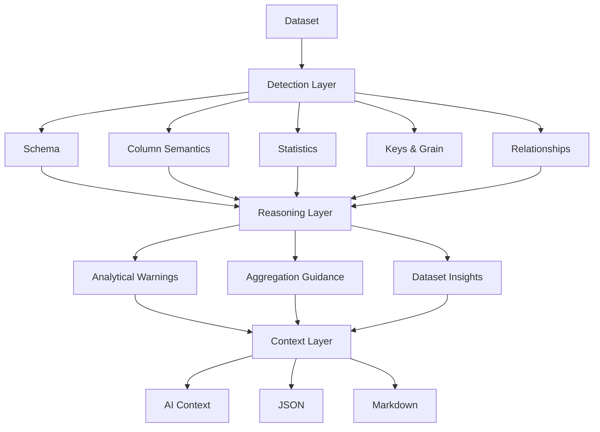

# DataContext

> **An open-source Python library for generating structured analytical context from datasets, designed to help AI coding agents write better data analysis code.**

[](#status) [](#requirements) [](#license)

---

## What is DataContext?

**DataContext is an open-source Python library** that analyzes a dataset and converts its structure, semantics, statistics, relationships, and potential analytical issues into **structured context that AI systems can consume**.

The idea is simple:

> **Give AI the context of the data before asking it to write pandas, SQL, or other analytical code.**

Modern AI coding agents are increasingly capable of generating data-analysis code. However, they often have limited knowledge about what a dataset actually represents.

For example, an AI may see:

```text
customer_id
order_id
product_id
quantity
revenue
order_date
```

but may not know:

- what one row represents
- which columns are identifiers
- which columns are measures
- whether an identifier is unique
- which aggregations make sense
- whether a join could multiply rows
- whether a numerical column contains unusual values
- which date column represents the relevant event

DataContext aims to make this information explicit.

---

## The idea

Without DataContext:



The AI has to infer the meaning of the dataset itself.

With DataContext:



DataContext acts as a lightweight **analytical context layer** between the data and the AI.

---

## Example

> 🚧 **Early development:** The API below represents the intended interface and may change before the first stable release.

```python
import pandas as pd

from datacontext import inspect

df = pd.read_csv("orders.csv")

context = inspect(df)

print(context.summary())
```

Generate AI-oriented context:

```python
ai_context = context.to_context()

print(ai_context)
```

A generated context could look like:

```text
DATASET
=======

Rows: 3,421,083
Columns: 10

LIKELY GRAIN
============

order_item

COLUMNS
=======

customer_id
  role: identifier
  unique: false
  missing: 0.3%

order_id
  role: identifier
  unique: false
  recommended operation: COUNT DISTINCT

revenue
  role: measure
  recommended aggregation: SUM
  negative values: 3.1%
  skew: high

order_date
  role: temporal
  range: 2017-01-01 → 2017-12-31

ANALYTICAL WARNINGS
===================

⚠ order_id is not unique
⚠ revenue contains negative values
⚠ revenue is highly skewed

ANALYTICAL GUIDANCE
===================

• Use COUNT(DISTINCT order_id) when counting orders.
• Do not aggregate order_id as a numeric measure.
• Revenue contains negative transactions.
• Consider median when comparing highly skewed revenue.
```

The resulting context can then be supplied to an AI coding agent along with the user's analytical request.

---

# What does DataContext analyze?

DataContext is designed to extract information from several layers of a dataset.

### Dataset structure

- Row and column counts
- Duplicate rows
- Candidate keys
- Likely dataset grain
- Basic dataset characteristics

### Column semantics

- Identifiers
- Measures
- Dimensions
- Categorical columns
- Dates and timestamps
- Boolean fields
- Text fields

### Statistical characteristics

- Missing values
- Cardinality
- Distribution
- Skewness
- Zero values
- Negative values
- Quantiles
- Potential outliers

### Analytical characteristics

- Recommended aggregations
- Identifier counting
- Potential aggregation risks
- Suspicious columns
- Temporal characteristics
- Potential analytical warnings

### Relationships

- Candidate primary keys
- Candidate foreign keys
- Column relationships
- Potential join risks

---

# Why dataset context matters

Consider:

```text
orders.csv

Rows: 100,000

order_id        → 12,000 unique
customer_id     → 4,200 unique
product_id      → 800 unique
revenue         → numeric
order_date      → date
```

A simple profiler can tell you that these columns exist.

But an AI-oriented context layer can provide:

```text
Likely grain:
  order × product

order_id:
  identifier
  not unique
  recommended operation: COUNT DISTINCT

customer_id:
  identifier
  not unique
  recommended operation: COUNT DISTINCT

revenue:
  measure
  additive candidate
  contains negative values
```

This distinction matters when an AI is asked to generate an analysis.

For example:

```sql
COUNT(order_id)
```

may produce a very different result from:

```sql
COUNT(DISTINCT order_id)
```

DataContext's job is to expose the information that can help an AI make that decision.

---

# Dataset grain

One of the core concepts DataContext aims to identify is:

> **What does one row represent?**

For example:

```text
Rows: 50,000

order_id
  unique: 8,421

product_id
  unique: 1,203

customer_id
  unique: 3,102

Likely grain:
  order × product
```

Understanding grain is important because many analytical mistakes come from confusing:

```text
rows
orders
customers
products
transactions
```

DataContext aims to make the likely grain and supporting evidence available to downstream AI systems.

---

# Aggregation guidance

DataContext can provide recommendations about how columns may be used.

For example:

```text
revenue

✓ SUM
✓ MEAN
✓ MEDIAN
✓ MIN
✓ MAX


quantity

✓ SUM
✓ MEAN


customer_id

✓ COUNT DISTINCT


order_id

✓ COUNT DISTINCT
✗ SUM
✗ MEAN
```

These are **recommendations based on observed data characteristics**, not guarantees.

DataContext should distinguish between:

- observed facts
- inferred semantics
- recommendations

rather than presenting every inference as certain.

---

# Analytical warnings

DataContext is designed to surface potentially important characteristics before an AI generates an analysis.

Examples:

```text
⚠ Identifier is not unique

⚠ High percentage of missing values

⚠ Highly skewed numerical distribution

⚠ Negative values detected in a potential measure

⚠ Duplicate rows detected

⚠ Potential aggregation risk

⚠ Date column contains gaps

⚠ High-cardinality categorical column
```

A warning should ideally provide:



The goal is not to automatically fix the problem.

The goal is to make the problem visible to the AI and the analyst.

---

# AI Context

The central purpose of DataContext is to transform dataset analysis into a compact representation suitable for AI systems.

```python
context.to_context()
```

Additional representations may include:

```python
context.to_dict()
context.to_json()
context.to_markdown()
```

The AI context should prioritize:

- relevant information
- analytical semantics
- warnings
- relationships
- aggregation guidance
- evidence

rather than dumping every available statistic into a prompt.

---

# Architecture

DataContext is designed around three main layers:



### Detection layer

Answers:

> **What do we observe?**

### Reasoning layer

Answers:

> **What might those observations mean analytically?**

### Context layer

Answers:

> **How should this information be presented to an AI system?**

---

# Design principles

### Deterministic first

The core library should not require an LLM.

```text
Dataset
   ↓
Deterministic analysis
   ↓
Structured context
   ↓
AI
```

AI integrations should be built on top of the core library rather than being required by it.

### Evidence over assumptions

DataContext should distinguish between observations and inferences.

Instead of:

```text
The dataset grain is order_item.
```

prefer:

```text
Likely grain: order_item

Evidence:
- order_id is duplicated
- product_id is duplicated
- order_id + product_id is mostly unique
```

### Context, not code generation

DataContext is not intended to become another AI data-analysis agent.

It does not aim to replace:

- pandas
- SQL
- DuckDB
- data-quality libraries
- AI coding agents
- AI data-analysis frameworks

It provides context that those systems can use.

### AI-provider independent

The core library should not depend on:

- OpenAI
- Anthropic
- Google
- LangChain
- LlamaIndex
- a specific AI coding agent

The generated context should be usable anywhere.

### Lightweight

DataContext aims to remain small, understandable and easy to integrate into existing Python data-analysis workflows.

---

# Roadmap

## v0.1 — DataFrame Context

- [ ] Dataset profiling
- [ ] Column type detection
- [ ] Semantic column detection
- [ ] Missing-value analysis
- [ ] Cardinality analysis
- [ ] Statistical context
- [ ] Candidate key detection
- [ ] Dataset grain estimation
- [ ] Aggregation recommendations
- [ ] Analytical warnings
- [ ] JSON output
- [ ] Markdown output
- [ ] AI context output

## v0.2 — Analytical Reasoning

- [ ] Relationship detection
- [ ] Join-risk detection
- [ ] Temporal analysis
- [ ] Improved grain detection
- [ ] Improved semantic inference
- [ ] Evidence/confidence metadata
- [ ] Context compression

## v0.3 — Additional Data Sources

- [ ] DuckDB
- [ ] Parquet
- [ ] CSV
- [ ] SQL databases

## v0.4 — AI Integrations

- [ ] MCP integration
- [ ] AI coding-agent examples
- [ ] Agent integrations
- [ ] Framework integrations

---

# Installation

DataContext currently supports Python 3.10+ and pandas 1.5+.

Install from a source checkout:

```bash
pip install .
```

For development:

```bash
git clone https://github.com/YOUR_USERNAME/datacontext.git

cd datacontext

python -m venv .venv
```

Activate the environment.

### Windows

```bash
.venv\Scripts\activate
```

### Linux / macOS

```bash
source .venv/bin/activate
```

Install the project in editable mode:

```bash
pip install -e ".[dev]"
```

Run tests:

```bash
pytest
```

---

# Project status

🚧 **Experimental — early development**

DataContext is an **open-source project under active development**.

The initial goal is to build a reliable pandas-based analytical context engine.

The API and internal architecture may change significantly before the first stable release.

If you are interested in the idea, feedback and contributions are welcome.

---

# Non-goals

DataContext is **not** intended to:

- Generate complete data analyses
- Replace pandas
- Replace SQL
- Automatically modify user data
- Guarantee analytical correctness
- Make decisions on behalf of an analyst
- Require an LLM for core functionality
- Become another generic EDA dashboard

The purpose is narrower:

> **Provide useful analytical context that helps humans and AI systems reason about data more accurately.**

---

## Contributing

Contributions are welcome. Useful contributions include:

- New semantic detection heuristics
- Better dataset-grain detection
- Statistical analysis
- Analytical warnings
- Relationship detection
- Tests using real-world datasets
- Documentation and examples
- Performance improvements
- Data-source integrations

Please open an issue to discuss significant changes to analytical behavior, the public API, dependencies, or architecture before implementation. Before opening a pull request, read the [Contributing Guide](CONTRIBUTING.md) for development setup, testing, and project conventions.

---

# License

DataContext is released under the [MIT License](LICENSE).

---

<p align="center">

**Data → Context → AI → Analysis**

</p>
